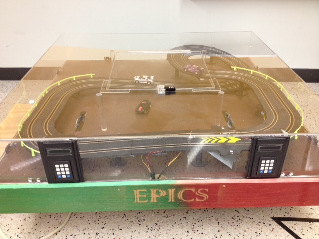
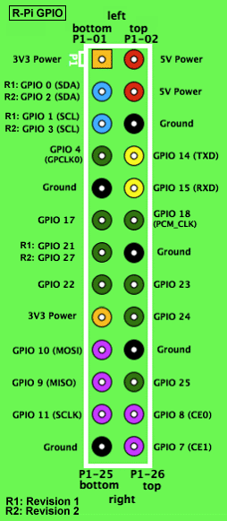
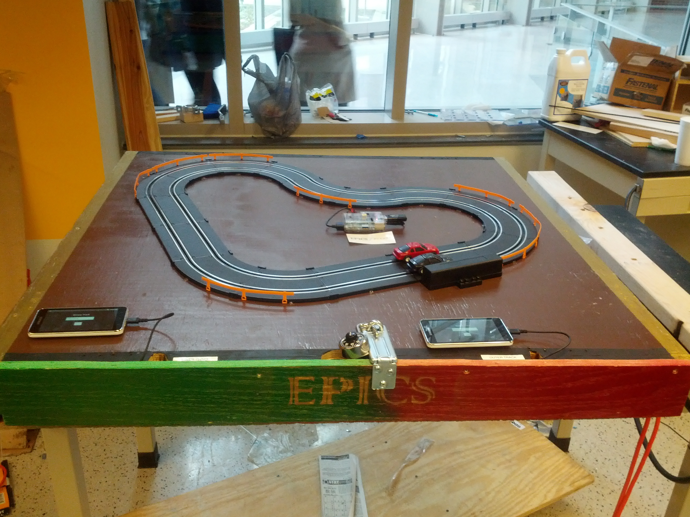

Engineering Projects in Community Service, better known as EPICS, brings university students together to build
solutions for nonprofit organizations. Each team works on a particular kind of project.

Our team, Greater Lafayette Elementary Education (GLEE), builds hands-on classroom projects at Happy Hollow Elementary
School. The idea is to give students something they can interact with while exploring math, science, technology, and
engineering.

GLEE has two teams: the learning racetrack team and the robotic arm team. We worked on the racetrack, which helps
sixth-grade students learn by racing cars. The original track was started in 2006 and worked when it was delivered to
the project partners. By the time we got to it, it needed some attention.

## Summary of project

Students race head to head by answering questions in different subjects. The questions fall into two groups: math
questions and multiple-choice questions.

- Math

  - Binary to decimal conversion
  - Decimal to binary conversion
  - Arithmetic
  - Basic Algebra

- Multiple Choice
  - English
  - Science
  - History
  - Etc

Students answer questions on an Android device. Each correct answer moves their car a little farther around the track.
The first student to finish three laps wins.

### Week 1



#### Problems/Tasks

Over the years, the track had become unreliable. Cars flew off the track, keypads worked inconsistently, and some cars
didn't respond at all. The wiring was disorganized, connections were loose, and the cars ran either too fast or too
slow. Staying on the track seemed like a reasonable first requirement for a racetrack.

#### Accomplishments

Assessed the project.

#### Decisions

As a team we decided to scrap the project and start from scratch.

#### Reflections

Starting over looked cheaper and easier than untangling the old wiring, and it would let us add more functionality.
The case and controller also limited how students could interact with the track. Even powering it on was awkward. We
wanted students to be able to play with the racetrack, rather than have the enclosure get in their way.

### Week 2

#### Problems/Tasks

We tackled two questions this week: how would students interact with the track, and how would we move the cars after a
correct answer? The existing keypads only accepted numbers. Moving the cars involved a jungle of wires and a logic
board running undocumented assembly. Whatever we built needed to be easier to develop and better documented. Leaving
the next team another mystery box wasn't much of an improvement.

#### Accomplishments

We came up with an initial design.

#### Decisions

We chose a Raspberry Pi because it was well documented and aimed at K-12 education. For the student interface, Android
gave us number input, text input, and multiple-choice questions. That opened up more subjects than the old numeric
keypads allowed, and Android had plenty of documentation to work from.

#### Reflections

We considered an Arduino board and the newer Raspberry Pi for controlling the cars. Both had advantages, but the Pi
was cheap and expandable, and nobody on our team had worked with Arduino.

For the student interface, we narrowed the choice to mobile devices or touch screens. Touch screens would cost less,
but we thought Android would make it easier to build a usable interface. We wanted to reuse existing solutions wherever
we could, spend less time developing and debugging, and leave documentation the next group of students could use.

### Week 3

#### Problems/Tasks

This week we worked out how teachers would add questions. The old logic board generated them, but our broader range
of question types meant teachers needed a way to choose what students would see.

#### Accomplishments

Designed how teachers would input questions into the system.

#### Decisions

We decided that teachers would enter questions on any computer that has access to a USB drive. Teachers would use a
program to take any number of questions they would like to be asked on the Android devices and format those questions
into a file. That file would then be placed onto a USB drive by the teacher and inserted into the Raspberry Pi. The
Raspberry Pi would parse the questions within the file and send those questions to the Android devices. We chose this
approach so teachers could create questions on any computer while staying within what the Android application could
handle.

#### Reflections

Adding questions needed to be straightforward for teachers, too. Typing long questions on an Android device sounded
tedious. Connecting a monitor and keyboard directly to the Pi meant finding spare equipment in a school. A Python
script and a USB drive seemed like a simpler way for teachers to enter questions and answers on a computer they already
had access to.

### Week 4

#### Problems/Tasks

It was time to gather the parts. Since the project would cost more than \$200, we needed to submit a budget.

#### Accomplishments

Found most of the items for our budget.

#### Decisions

We still needed to research which device we would use for the students to interact with the racetrack. We narrowed it
down to a cheap Walmart tablet or a Samsung Galaxy media player.

#### Reflections

Most of the pieces we need to budget had already been decided on. We needed to find where we could buy these pieces for
as cheap as possible while still ordering from an authorized seller. Most of our pieces would be coming from
element14.com and amazon.com since they had the best price for the parts.

### Week 5

#### Problems/Tasks

An itemized budget needed to be created. We needed to make sure that we spent as little as possible so that the overall
cost of maintenance would be low.

#### Accomplishments

An itemized budget was created and submitted.

#### Decisions

The Android devices were our biggest expense. We needed enough screen space to display the questions, a reputable
manufacturer, and a price we could afford. After comparing devices, we chose a used Samsung Galaxy media player. Buying
used gave us better specifications for the money.

#### Reflections

We were wary of saving money on an unfamiliar Android device only to spend it back in development time. Screen space
was another concern. Samsung's large Android user base made us more confident that we'd be able to find help with
software or hardware issues. That was our reasoning for buying a used Samsung device rather than a cheaper unknown one.

### Week 6

#### Problems/Tasks

Start development on the Android application.

#### Accomplishments

Created an Android application that tests users on their ability to convert binary to decimal.

#### Decisions

We started with a simple Android application that asks the user to convert a binary number to decimal. It uses the
default Android keyboard for input. When the user presses Done, the application evaluates the answer and displays a
Toast pop-up saying "You are right" or "You are wrong." We chose a Toast rather than a dialog so students could move
on to the next question without dismissing another prompt.

#### Reflections

The small application gave us a way to try the whole interaction: display a question, accept an answer, give feedback,
and move on. We could build on that instead of trying to design every question type at once.

### Week 7

This week we presented the project to corporate sponsors, including Eaton and PPG, at a design review. We demoed the
application and answered questions about durability and why we'd chosen to rebuild the project from scratch.

### Week 8

#### Problems/Tasks

Submit order form for parts. Start documenting what our question would look like and what is in the scope of a question.
We had to decide how many characters each answer could be, and what kind of question required what kind of answer
scheme.

#### Accomplishments

Submitted the order form for parts. Started documenting how questions can be formatted.

#### Decisions

We decided to create a design document for the types of questions to use for the Android application. The design
document clearly states the scope of what questions will be included in the application. We decided that 20 characters
or less for any answer will allow the text to be displayed legibly on the screen. Multiple choice questions are limited
to 2 or 4 answers so that all answers can be displayed on the screen at once. We also decided on which type of math
questions will be included into the application.

#### Reflections

We decided before continuing to write our application that we should clearly state what kind of questions we can receive
and how they should be handled. This allows us to create our application to have different screens depending on what
type of question is being asked. This creates a much cleaner looking interface.

### Week 9

#### Problems/Tasks

Set up the Raspberry Pi and other materials that have arrived.

#### Accomplishments

Installed operating system on the Raspberry Pi.

#### Decisions

We went with Raspbian "Wheezy" since it is one of the "officially" listed operating systems on Raspberry Pi
[website](http://www.raspberrypi.org/downloads). This OS comes with most features we need pre-installed.

#### Reflections

Raspbian "Wheezy" is based on [Debian](http://www.debian.org/), but it doesn't include all of Debian's software. Most of
what we need for this project is available in Raspbian. The default login information is:

```bash
Username: pi
Password: raspberry
```

### Week 10

#### Problems/Tasks

Start research on what will be required to use the Raspberry Pi's GPIO ports. Find out more information about how the
Raspberry Pi's GPIO ports work and what they can and cannot do.

#### Accomplishments

Found several resources explaining in detail about the Raspberry Pi's GPIO ports.
[Embedded Linux](http://elinux.org/RPi_Low-level_peripherals) is a great resource to find out more about the Raspberry
Pi's low-level peripherals.

#### Reflections

There were some important quirks with the Raspberry Pi that must be noted. The GPIO ports can only send 3.3V with
2 mA to 16 mA. The GPIO ports are also not 5V tolerant and there is no over-voltage protection. The picture below shows
the ports and their functions.



### Week 11

#### Problems/Tasks

Start writing software for teachers to create new questions. Start writing code to use the Raspberry Pi's GPIO ports.

#### Accomplishments

Team has started working on code for teachers. Found
[sample code](https://github.com/jaye773/epics_binary_track/blob/master/gpioControls/buttonLED.c) that turns on an LED
on button press. Found a
[Raspberry Pi GPIO tutorial](http://log.liminastudio.com/writing/tutorials/tutorial-how-to-use-your-raspberry-pi-like-an-arduino)
for sending and receiving signals.

#### Decisions

We decided to go with Python for our Question code since there are easy ways to make it an executable and development of
code would be quite easy. We have selected GPIO ports 23 and 24 to use since they serve no other predefined function
making debugging much easier.

#### Reflections

We went with C code for the GPIO since it is much easier to connect to the ports in C and send out signals than it would
be in Python or Bash.

### Week 12

#### Problems/Tasks

Get the moveCars.c program to compile and run. Start wiring our circuit to connect the Raspberry Pi to the racetrack.

#### Accomplishments

We had to install WiringPi from source so we would have full functionality of the GPIO ports. Debugged several issues
with MoveCars.c related to GPIO numbering conventions. Using a breadboard, we also built a functional circuit to send
signals from the Pi to the track.

#### Reflections

We followed the
[WiringPi installation instructions](https://projects.drogon.net/raspberry-pi/wiringpi/download-and-install/). We had a
few issues installing it with GitHub until we did a full system update. Once that was installed we found out our code
has to be compiled with the wiringPi library:

```bash
gcc -o moveCars moveCars.c -lwiringPi
```

We have to run our GPIO code as sudo:

```bash
sudo ./moveCars 1
```

### Week 13

#### Problems/Tasks

Create code for transferring question files to each of the Android tablets.

#### Accomplishments

We can dynamically mount the USB drive whether at startup or while the game is running.

#### Reflections

We had an issue where the USB drive would change letter names from sda to sdb to sdc or sdd or sde randomly at startup.
This can be found by typing the following command:

```bash
ls /dev/sd?1
```

This will result in some output like:

```bash
/dev/sda1
```

This means that we must mount /dev/sda1 to /media/usb0 with this command:

```bash
sudo mount /dev/sda1 /media/usb0
```

We were able to fix this issue by installing software called [usbmount](http://usbmount.alioth.debian.org/). This will
auto-mount USB drives when the operating system is already running. A major issue encountered while trying to get this
to work is that the USB drive has to be directly connected to the USB port on the Raspberry Pi without the use of a USB
hub or a USB extender cable. Sources that helped with debugging:
[Mounting random USB drives to a mount point](http://www.raspberrypi.org/phpBB3/viewtopic.php?f=26&t=38105),
[How to Mount USB Disks on Raspberry Pi](http://ccollins.wordpress.com/2013/02/04/how-to-mount-usb-disks-on-linux/),
[Unable to mount USB Stick on RPi](http://www.element14.com/community/thread/21093),
[How to mount a USB drive to your Raspberry Pi](http://frustrateditengineer.wordpress.com/2012/09/23/how-to-mount-a-usb-drive-to-your-raspberry-pi/),
[How to mount and use a USB hard disk with the Raspberry Pi](http://raspi.tv/tag/mount-usb-hard-drive-on-raspberry-pi)

### Week 14

#### Problems/Tasks

We have started mounting everything to the base.

#### Accomplishments

The Raspberry Pi is mounted on the base. We added an external power cable so the user doesn't have to pull the surge
protector out of the base to turn everything on. We also soldered the wires connecting the Raspberry Pi to the track.

#### Reflections

We found a few issues with the old cover and decided against using it. We still need a way to secure the wires and
Android tablets during use.

### Week 15

#### Problems/Tasks

Finish mounting items on the base and secure everything.

#### Accomplishments

The base has the track secured to it. The Android tablets have been labeled so we can identify who is in the inner track
vs who is in the outer track. We also have a place inside the base to store the cars and Android tablets when not in
use. We have hot glued all the connections that are exposed so that they cannot be accidentally unplugged.

#### Reflections

We have found a way to hide all the cables that connect the track to the Raspberry Pi. We drilled a small hole in the
base, ran the cables through it, and placed the track over the hole so the sensitive wires aren't exposed.



All source code can be found on [GitHub](https://github.com/jaye773/epics_binary_track)
